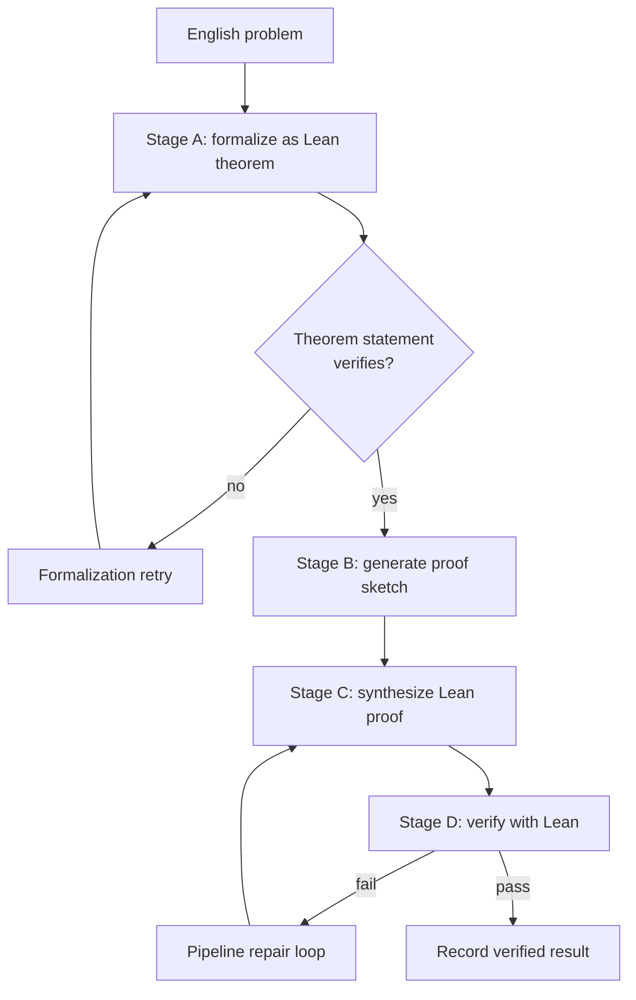

# NL2Lean: Compiler-Guided Repair

**Research topic:** Compiler-Guided Repair for Natural-Language-to-Lean
Formalization.

## Project overview

This repository contains a research prototype for translating natural-language
mathematics into Lean and evaluating proof repair. The central research
question is:

> Does compiler-diagnostic feedback improve proof repair compared with
> equally budgeted retries without compiler feedback, and for which error
> types?

The repository includes an end-to-end NL-to-Lean pipeline and a separate
paired experiment runner. The primary study is designed to compare repair
conditions from the same fixed Lean theorem and the same initial proof
candidate, rather than treating ordinary pipeline pass rates as evidence for
the research question.

## Research status

**In progress — no completed A/B/C evaluation is reported here.** The research
dataset remains a draft of 21 candidates, with **0 eligible records** under
the current curation validator. It is not a completed benchmark, frozen test
set, or experiment-ready dataset.

The existing `RUN_REPORT.md` and result files describe historical prototype
work, not the controlled A/B/C study. The report explicitly says candidate
proofs in that run were authored manually rather than generated through model
API calls; some Lean compilation checks were real, but those checks do not
turn the run into genuine API-generated experiment outcomes. Do not present
historical, manual, or simulated results as model-generated results.

The Springer LNCS manuscript draft and its claims-to-evidence audit are in
[`paper/`](paper/). The draft reports no A/B/C findings because the dataset
has zero eligible records and there are no paired API run manifests. See
[`docs/reproducibility.md`](docs/reproducibility.md) for exact environment,
validation, analysis, and paper-build instructions. This repository does not
yet have a submission-ready paper or reproducibility package.

## Pipeline

The original end-to-end pipeline is:



This pipeline is separate from the paired repair experiment and its metrics
must not be interpreted as a controlled comparison of compiler feedback
against blind retries.

## Repository structure

```text
.
├── README.md
├── RUN_REPORT.md                         # historical run and limitations
├── data/
│   ├── schema.md
│   ├── seed_problems.json
│   ├── research_dataset_draft_v0.1.0.json
│   ├── curation_ledger_v0.1.0.json
│   ├── research_dataset_manifest_v0.1.0.json
│   ├── curation_guide.md
│   ├── curation_audit_v0.1.1.md
│   └── results/                         # historical and pilot outputs
├── eval/
│   └── metrics.py
├── lean_project/
│   ├── lean-toolchain
│   ├── lakefile.toml
│   └── lake-manifest.json
├── prompts/
│   ├── stage_a_formalize.txt
│   ├── stage_b_sketch.txt
│   ├── stage_c_synthesize.txt
│   ├── stage_d_repair.txt
│   ├── repair_experiment_initial.txt
│   ├── repair_experiment_blind.txt
│   └── repair_experiment_compiler_guided.txt
├── src/
│   ├── pipeline.py
│   ├── formalize.py
│   ├── proof_sketch.py
│   ├── synthesize.py
│   ├── verify.py
│   ├── repair_experiment.py
│   ├── dataset_validation.py
│   ├── build_research_dataset_draft.py
│   └── llm_client.py
└── tests/
    ├── test_dataset_validation.py
    ├── test_repair_experiment.py
    └── test_verify.py
```

The full test inventory is under `tests/`; the dataset draft and its curation
materials are versioned separately from the original seed records.

## Dataset and curation workflow

Before a record can be counted as eligible, curate and document:

1. **Source and rights:** identify a reliable source or document verified
   hand-authored provenance; check the actual rights/license evidence and
   permission for redistribution and publication. A public webpage alone is
   not evidence of a redistribution license.
2. **Theorem and assumptions:** have a qualified reviewer compare the complete
   English statement and Lean theorem, including types, quantifiers,
   assumptions, notation, and boundary cases. Resolve any missing, excessive,
   or mismatched assumptions.
3. **Semantic fidelity and self-containment:** record an evidence-based
   `faithful`, `not faithful`, or `uncertain` label with reviewer provenance.
   Check required definitions, imports, notation, and the intended Lean
   environment. Compilation alone does not establish semantic fidelity.
4. **Duplicates and families:** adjudicate exact-English and likely
   mathematical duplicates; record family decisions with evidence. Similarity
   is a review lead, not proof of equivalence. Do not count an unresolved
   duplicate group as multiple independent examples.
5. **Splitting:** assign accepted theorem families wholly to development or
   test. The split must be deterministic, reviewed, and free of family
   leakage.
6. **Eligibility and freezing:** validate the metadata and evidence, resolve
   exclusions, check the final record counts, and independently verify the
   exact-byte manifest hash. Freeze only after required evidence-based reviews
   are complete and the target counts are met.

The current pool is far below the target: the proposed split is 15 development
and 6 test candidates; counting the exact-English duplicate pair at most once
leaves at most 14 independent development and 6 test candidates. The current
validator reports zero eligible candidates. The minimum target is at least
15 development and 60 independent held-out test items; 15–20 development
items are preferred.

The record-level review leads and freeze checklist are in
[`data/curation_audit_v0.1.1.md`](data/curation_audit_v0.1.1.md). In
particular, the exact-English pair `arith_003` / `arith_003_mathlib` still
requires human adjudication. The draft has no verified source/license
evidence, and theorem-statement, assumption, semantic-fidelity,
self-containment, family, and split reviews remain incomplete.

### Structural validation

Using the repository’s Python virtual environment:

```bash
PYTHONDONTWRITEBYTECODE=1 ./.venv/bin/python src/dataset_validation.py \
  data/research_dataset_draft_v0.1.0.json \
  --validate-curation-draft
```

This validates draft structure, IDs, allowed metadata, duplicate candidates,
and family/split consistency, and reports the current eligible count. A
successful structural validation is **not** proof of mathematical
correctness, source authenticity, redistribution rights, semantic fidelity,
or successful Lean compilation.

## Experimental design

The intended controlled comparison has three conditions:

- **A — ONE-SHOT:** generate one initial proof candidate and make no repair
  calls.
- **B — BLIND RETRY:** from the same failed initial candidate, make up to
  three repair calls using the predefined generic retry prompt and previous
  candidate, without compiler diagnostics.
- **C — COMPILER-GUIDED REPAIR:** from that exact same failed initial
  candidate, make up to three repair calls using actual Lean compiler
  diagnostics.

The B/C comparison must hold the problem and human-reviewed theorem, initial
candidate, primary LLM/model identifier, repair-call limit, applicable
decoding settings and comparable prompt/token budgets, and Lean/Mathlib
environment constant. Outcomes must be paired by problem and initial-candidate
identity. These experiments have **not** been reported as run.

The runner is `src/repair_experiment.py`; it uses the three
`prompts/repair_experiment_*.txt` templates. Its configured default is three
repair calls, and it accepts an explicit model identifier. The runner records
the requested model identifier as a provider alias, not an immutable model
revision. `--plan-only` prints the planned configuration without writing
experiment files or calling the API. Running the experiment itself invokes
the configured model provider and Lean verifier; do so only after dataset,
protocol, and API-budget approval.

## Reproducibility and environment

Repository configuration currently specifies:

- Lean toolchain: `leanprover/lean4:v4.32.0` in
  `lean_project/lean-toolchain`.
- Mathlib: the `mathlib4` dependency declared in `lean_project/lakefile.toml`,
  pinned by `lean_project/lake-manifest.json` to revision
  `81a5d257c8e410db227a6665ed08f64fea08e997`.
- Python API dependency: `groq>=0.9.0` in `requirements.txt`.

These are configured versions and pins, not evidence that every dataset
candidate compiles. The current draft contains unresolved statements and
definitions; no compilation result is implied by the configuration.

## Validation and testing

Run the focused offline curation tests with:

```bash
PYTHONDONTWRITEBYTECODE=1 ./.venv/bin/python -m pytest \
  -p no:cacheprovider tests/test_dataset_validation.py -q
```

Run the offline project tests while excluding the two tests explicitly marked
to invoke real Lean through Lake with:

```bash
PYTHONDONTWRITEBYTECODE=1 ./.venv/bin/python -m pytest \
  -p no:cacheprovider tests -q -k 'not test_real_lean'
```

The full suite includes real-Lean integration tests when `lake` is installed;
those tests compile Lean and should only be run when compilation is intended.
Python unit-test success does not certify dataset semantics, licensing, or
Lean compilation.

## Historical prototype artifacts

`RUN_REPORT.md` documents the historical 20-problem core-Lean-adapted run and
its limitations. The report distinguishes real compiler invocations from
manually authored proof candidates and explicitly states that the configured
LLM API was not called for those candidates. Existing result files and charts
are retained for historical context only; they are not evidence for the
paired A/B/C research question or a current benchmark.

Charts associated with those historical artifacts:

### Pass@1 by category


### Pass@1 by difficulty


### Repair attempts to success


### Difficulty vs. repair attempts


## Research integrity

Do not report historical, manually authored, or simulated outcomes as genuine
API-generated experiment results. Record model/provider provenance and the
actual generation path for any future experiment. Likewise, a theorem that
compiles is not thereby shown to faithfully formalize its English statement:
source rights, assumptions, mathematical meaning, and semantic fidelity
require their own evidence and review.

## Current milestone and next steps

The current milestone is a **reviewable draft curation audit**, not a frozen
dataset. Next:

1. Find and verify source and redistribution/license evidence for each
   candidate, leaving unresolved cases pending.
2. Review each English/Lean pair, especially the assumption concern in
   `mod_001`, indexing in `ind_001`, and missing `geomSum` definition in
   `ind_004`.
3. Adjudicate the exact-English duplicate and review potential mathematical
   duplicates and family memberships.
4. Build a deterministic family-aware split from reviewed, eligible records;
   acquire legitimate additional source material to meet the held-out target.
5. Revalidate and prepare a new, reproducible manifest only after the
   evidence and review requirements are met; then finalize the A/B/C protocol
   before running experiments.

For broader project context, see [`docs/architecture.md`](docs/architecture.md),
[`docs/roadmap.md`](docs/roadmap.md), [`docs/dataset_card.md`](docs/dataset_card.md),
[`docs/model_card.md`](docs/model_card.md), and [`docs/verification.md`](docs/verification.md).
