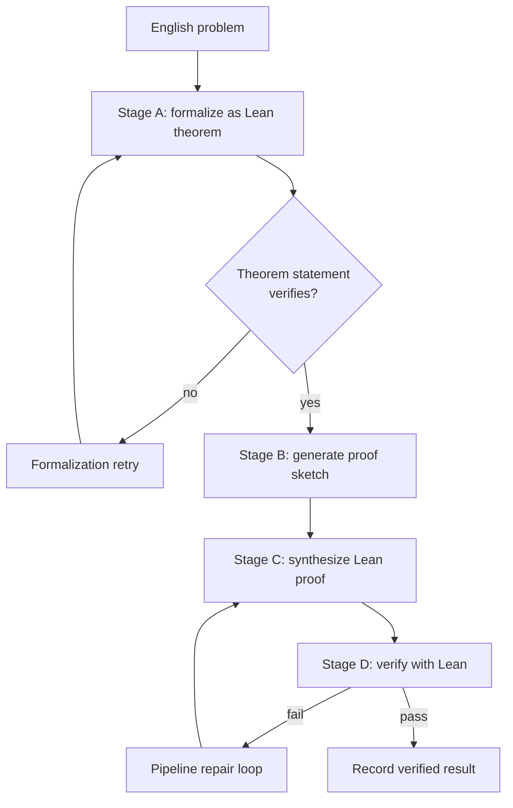
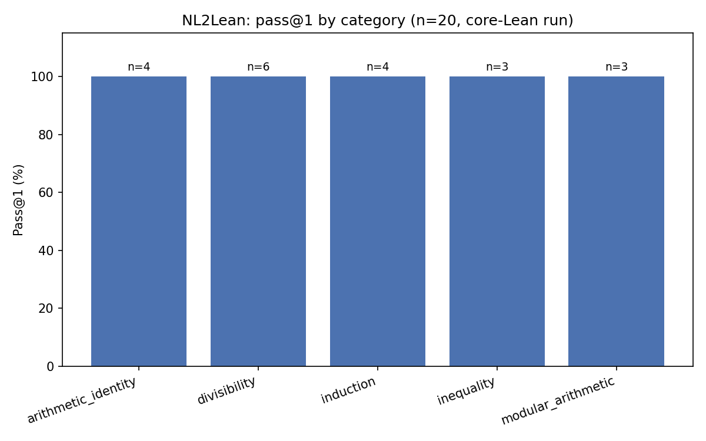
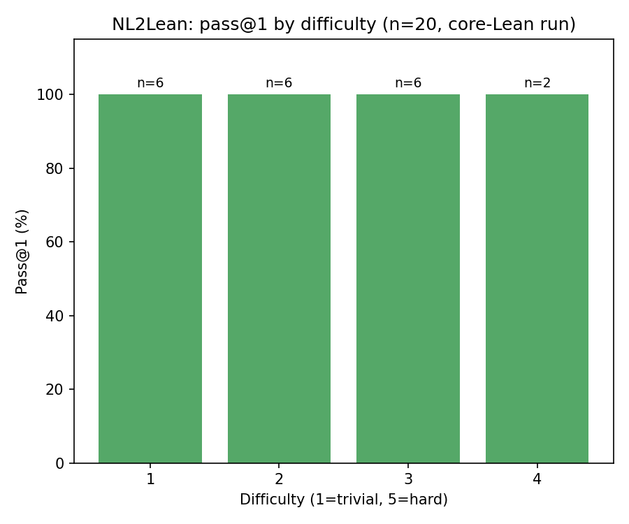
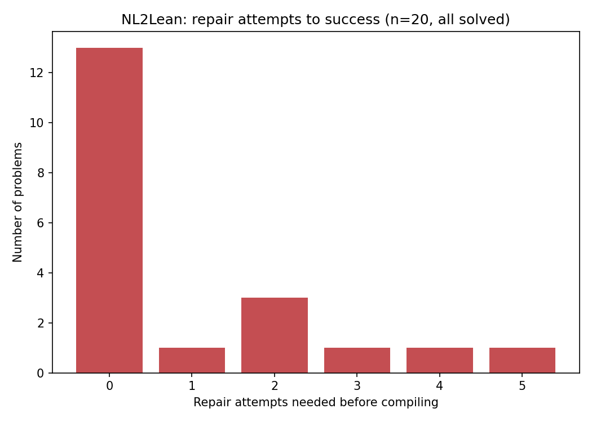
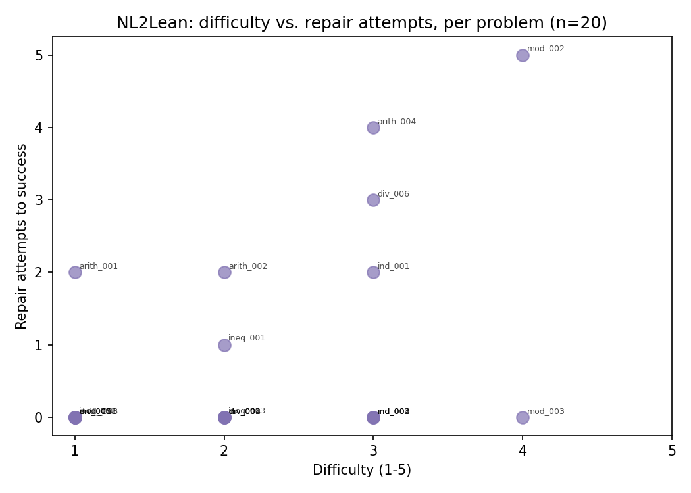

# NL2Lean: Compiler-Guided Repair

**Research topic:** Compiler-Guided Repair for Natural-Language-to-Lean
Formalization.

## Project overview

This repository contains a research prototype for translating natural-language
mathematics into Lean and evaluating proof repair. The central research
question is:

> Does compiler-diagnostic feedback improve proof repair compared with
> equally budgeted retries without compiler feedback, and for which error
> types?

The repository includes an end-to-end NL-to-Lean pipeline and a separate
paired experiment runner. The primary study is designed to compare repair
conditions from the same fixed Lean theorem and the same initial proof
candidate, rather than treating ordinary pipeline pass rates as evidence for
the research question.

## Research status

**In progress — no completed A/B/C evaluation is reported here.** The current
curation inventory contains **35 candidates**: 27 assigned to a proposed
development split and 8 to a proposed test split. The validator reports
**0 eligible records** in either split. Five categories are represented:
arithmetic identity, divisibility, induction, inequality, and modular
arithmetic. This remains an unfrozen candidate pool, not an experiment-ready
benchmark.

The existing `RUN_REPORT.md` and result files describe historical prototype
work, not the controlled A/B/C study. The report explicitly says candidate
proofs in that run were authored manually rather than generated through model
API calls; some Lean compilation checks were real, but those checks do not
turn the run into genuine API-generated experiment outcomes. Do not present
historical, manual, or simulated results as model-generated results.

The Springer CCIS/LNCS-format manuscript draft and its claims-to-evidence audit
are in [`paper/`](paper/). The draft reports no A/B/C findings because the
dataset has zero eligible records and there are no paired A/B/C run manifests.
The latest inventory records 10 candidates with strict Lean proof-verification
evidence, 0 with complete reviews, and 87 curation warnings. Fourteen sourced
candidates have DMOI3 item citations, but source-page bytes were not archived
for the latest acquisition batches and independent rights clearance is 0.
The original 21 draft records lack item-level source citations. See
[`docs/reproducibility.md`](docs/reproducibility.md) for exact environment,
validation, analysis, and paper-build instructions. This repository does not
yet have a submission-ready paper or reproducibility package.

### Professor's M1–M7 revision status

This status tracks the mandatory outcomes in the 20 October 2026 major
revision plan. It does not predict acceptance.

| Requirement | Done so far | Still required |
|---|---|---|
| **M1 — Genuine automated runs** | Paired runner and trace format implemented. No paired A/B/C run manifests found. Historical pilot files are not treated as paired API evidence because they lack required execution metadata and conditions. | Pass dataset, protocol, account, quota, and approval gates; then run and preserve a genuine API pilot and study. |
| **M2 — Frozen independent test set** | 35 candidates: 27 proposed development, 8 proposed test; 0 eligible. Five categories represented. | Acquire and review enough rights-cleared examples for 15–20 eligible development and at least 60 eligible held-out test items; separate whole theorem families; freeze and hash. |
| **M3 — Feedback baseline** | Protocol v0.2.0 and runner specify A one-shot, B blind retry, C compiler-guided repair, shared initial candidate, and up to three repairs for B/C. | Obtain independent protocol approval and validate the paired lifecycle in an approved pilot. |
| **M4 — Semantic faithfulness** | Review templates and packets exist; independent completed reviews: 0. | Qualified independent reviewers must label English/Lean pairs; report end-to-end translation fidelity separately from fixed-theorem repair. |
| **M5 — Metrics and statistics** | Paired-analysis code and synthetic tests exist. Readiness audit computed no study metrics. | Analyze genuine traces with denominators, uncertainty, paired tests, multiplicity correction, missing-run accounting, and resource usage. |
| **M6 — Pinned environment and proof integrity** | Lean `v4.32.0` and pinned Mathlib revision configured; `lake build` passed on 21 October 2026; verifier has forbidden-proof checks. | Verify each selected reference theorem in that environment and preserve theorem-level evidence and hashes. |
| **M7 — Evidence-backed paper** | Manuscript and claims audit exist; unsupported results are unavailable. | Generate required tables, figures, and examples from validated raw traces; finish limitations and independent claims review. |

The experiment gate remains closed. Protocol v0.2.0 is proposed, not
independently approved or preregistered. Groq account-specific generation
access and free-tier status are unverified. No live API calls were made during
the latest repository audit/update pass.

## Pipeline

The original end-to-end pipeline is:



This pipeline is separate from the paired repair experiment and its metrics
must not be interpreted as a controlled comparison of compiler feedback
against blind retries.

## Repository structure

```text
.
├── README.md
├── RUN_REPORT.md                         # historical run and limitations
├── data/
│   ├── schema.md
│   ├── seed_problems.json
│   ├── research_dataset_draft_v0.1.0.json
│   ├── curation_ledger_v0.1.0.json
│   ├── research_dataset_manifest_v0.1.0.json
│   ├── curation_guide.md
│   ├── curation_batches/                # sourced candidate batches, pending
│   ├── review_packets/                  # review materials, pending review
│   ├── research_dataset_inventory_v0.2.2.json
│   ├── source_acquisition_ledger_v0.1.2.json
│   ├── curation_audit_v0.1.3.md
│   └── results/                         # historical and pilot outputs
├── eval/
│   ├── metrics.py
│   └── paired_analysis.py
├── lean_project/
│   ├── lean-toolchain
│   ├── lakefile.toml
│   └── lake-manifest.json
├── prompts/
│   ├── stage_a_formalize.txt
│   ├── stage_b_sketch.txt
│   ├── stage_c_synthesize.txt
│   ├── stage_d_repair.txt
│   ├── repair_experiment_initial.txt
│   ├── repair_experiment_blind.txt
│   └── repair_experiment_compiler_guided.txt
├── src/
│   ├── pipeline.py
│   ├── formalize.py
│   ├── proof_sketch.py
│   ├── synthesize.py
│   ├── verify.py
│   ├── repair_experiment.py
│   ├── dataset_validation.py
│   ├── build_research_dataset_draft.py
│   └── llm_client.py
└── tests/
    ├── test_dataset_validation.py
    ├── test_repair_experiment.py
    └── test_verify.py
```

The full test inventory is under `tests/`; the dataset draft and its curation
materials are versioned separately from the original seed records.

## Dataset and curation workflow

Before a record can be counted as eligible, curate and document:

1. **Source and rights:** identify a reliable source or document verified
   hand-authored provenance; check the actual rights/license evidence and
   permission for redistribution and publication. A public webpage alone is
   not evidence of a redistribution license.
2. **Theorem and assumptions:** have a qualified reviewer compare the complete
   English statement and Lean theorem, including types, quantifiers,
   assumptions, notation, and boundary cases. Resolve any missing, excessive,
   or mismatched assumptions.
3. **Semantic fidelity and self-containment:** record an evidence-based
   `faithful`, `not faithful`, or `uncertain` label with reviewer provenance.
   Check required definitions, imports, notation, and the intended Lean
   environment. Compilation alone does not establish semantic fidelity.
4. **Duplicates and families:** adjudicate exact-English and likely
   mathematical duplicates; record family decisions with evidence. Similarity
   is a review lead, not proof of equivalence. Do not count an unresolved
   duplicate group as multiple independent examples.
5. **Splitting:** assign accepted theorem families wholly to development or
   test. The split must be deterministic, reviewed, and free of family
   leakage.
6. **Eligibility and freezing:** validate the metadata and evidence, resolve
   exclusions, check the final record counts, and independently verify the
   exact-byte manifest hash. Freeze only after required evidence-based reviews
   are complete and the target counts are met.

The latest inventory snapshot is
[`data/research_dataset_inventory_v0.2.2.json`](data/research_dataset_inventory_v0.2.2.json),
and the latest audit is [`data/curation_audit_v0.1.3.md`](data/curation_audit_v0.1.3.md).
They record 27 proposed development and 8 proposed test candidates, with zero
eligible examples in both splits. There is one exact-English duplicate group
(`arith_003` / `arith_003_mathlib`); likely-duplicate pairs and a declared
cross-split family concern also await human adjudication. Proposed split
assignments and source/license fields are not equivalent to completed review
or rights clearance.

The 14 newly cited DMOI3 items remain pending source-byte capture and rights
review. Independent semantic-fidelity, theorem-statement, self-containment,
family, and split reviews are incomplete. Source licenses must be assessed at
the relevant item/source level; public accessibility alone is not reuse
permission. For example, the [miniF2F repository](https://github.com/facebookresearch/miniF2F)
identifies its Lean directory as Apache licensed, while its informal problems
are attributed to MATH, AOPS, and human annotation; those underlying source
rights require separate review. [OpenStax Calculus](https://openstax.org/books/calculus-volume-1/pages/preface)
is CC BY-NC-SA 4.0 and its terms prohibit ingestion into generative AI
offerings without prior written permission; do not use its content in API
prompts unless that restriction is resolved.

### Structural validation

Using the repository’s Python virtual environment:

```bash
PYTHONDONTWRITEBYTECODE=1 ./.venv/bin/python src/dataset_validation.py \
  data/research_dataset_draft_v0.1.0.json \
  --validate-curation-draft
```

This validates the base draft structure, IDs, allowed metadata, duplicate
candidates, and family/split consistency. It reports zero eligible records
for the base 21-record draft. The combined draft-plus-batch inventory was also
checked with `validate_curation_draft`: 35 candidates, 0 eligible, 0
structural errors, and 87 review warnings. A
successful structural validation is **not** proof of mathematical
correctness, source authenticity, redistribution rights, semantic fidelity,
or successful Lean compilation.

## Experimental design

The intended controlled comparison has three conditions:

- **A — ONE-SHOT:** generate one initial proof candidate and make no repair
  calls.
- **B — BLIND RETRY:** from the same failed initial candidate, make up to
  three repair calls using the predefined generic retry prompt and previous
  candidate, without compiler diagnostics.
- **C — COMPILER-GUIDED REPAIR:** from that exact same failed initial
  candidate, make up to three repair calls using actual Lean compiler
  diagnostics.

The B/C comparison must hold the problem and human-reviewed theorem, initial
candidate, primary LLM/model identifier, repair-call limit, applicable
decoding settings and comparable prompt/token budgets, and Lean/Mathlib
environment constant. Outcomes must be paired by problem and initial-candidate
identity. These experiments have **not** been reported as run.

The runner is `src/repair_experiment.py`; it uses the three
`prompts/repair_experiment_*.txt` templates. Its configured default is three
repair calls, and it accepts an explicit model identifier. The runner records
the requested model identifier as a provider alias, not an immutable model
revision. `--plan-only` prints the planned configuration without writing
experiment files or calling the API. Running the experiment itself invokes
the configured model provider and Lean verifier. It remains blocked pending
an eligible frozen dataset, protocol approval, and verified account/quota
controls. Do not evaluate the test split before it is frozen.

## Reproducibility and environment

Repository configuration currently specifies:

- Lean toolchain: `leanprover/lean4:v4.32.0` in
  `lean_project/lean-toolchain`.
- Mathlib: the `mathlib4` dependency declared in `lean_project/lakefile.toml`,
  pinned by `lean_project/lake-manifest.json` to revision
  `81a5d257c8e410db227a6665ed08f64fea08e997`.
- Python API dependency: `groq>=0.9.0` in `requirements.txt`.

These are configured versions and pins, not evidence that every dataset
candidate compiles. The current draft contains unresolved statements and
definitions; no compilation result is implied by the configuration.

## Validation and testing

Run the focused offline curation tests with:

```bash
PYTHONDONTWRITEBYTECODE=1 ./.venv/bin/python -m pytest \
  -p no:cacheprovider tests/test_dataset_validation.py -q
```

The full suite was last run on 21 October 2026:

```text
219 passed, 19 subtests passed
```

Run it with:

```bash
PYTHONDONTWRITEBYTECODE=1 ./.venv/bin/python -m pytest \
  -p no:cacheprovider -q
```

The pinned Lean build also completed on 21 October 2026:

```bash
cd lean_project && lake build
```

Result: `Build completed successfully (8657 jobs)`. Test and build success do
not certify dataset eligibility, source rights, or semantic fidelity.

## Historical prototype artifacts

`RUN_REPORT.md` documents the historical 20-problem core-Lean-adapted run and
its limitations. The report distinguishes real compiler invocations from
manually authored proof candidates and explicitly states that the configured
LLM API was not called for those candidates. Existing result files and charts
are retained for historical context only; they are not evidence for the
paired A/B/C research question or a current benchmark.

Charts associated with those historical artifacts:

### Pass@1 by category


### Pass@1 by difficulty


### Repair attempts to success


### Difficulty vs. repair attempts


## Research integrity

Do not report historical, manually authored, or simulated outcomes as genuine
API-generated experiment results. Record model/provider provenance and the
actual generation path for any future experiment. Likewise, a theorem that
compiles is not thereby shown to faithfully formalize its English statement:
source rights, assumptions, mathematical meaning, and semantic fidelity
require their own evidence and review.

## Current milestone and next steps

The current milestone is **dataset construction and review preparation**, not
a frozen dataset or an approved experiment. Next:

1. Archive item-level source evidence, establish applicable redistribution
   rights, and obtain permission where source terms require it.
2. Complete independent theorem, semantic-fidelity, self-containment,
   source-rights, family, and split reviews. Keep unreviewed decisions pending.
3. Acquire and verify enough distinct records for at least 15 eligible
   development and 60 eligible test items. Keep near-duplicate theorem
   families within one split.
4. Freeze and hash reviewed splits only after evidence, human-review,
   validator, and count requirements pass. Keep test data out of prompt tuning
   and model selection.
5. Obtain protocol approval and verify Groq account tier, model access, and
   quota safeguards. Run the smallest approved pilot only after every gate
   passes; validate it before starting the main study.
6. Generate statistical outputs and manuscript results from validated raw
   artifacts and complete an independent claims review.

The professor's schedule targets protocol evidence by 22 October, a pilot by
25 October, the frozen dataset and paired runs by 29 October, analysis by 31
October, a complete manuscript by 3 November, final review by 4 November, and
submission by 5 November 2026. These are target dates, not completed
milestones; the outstanding dataset and approval gates put the schedule at
risk.

For broader project context, see [`docs/architecture.md`](docs/architecture.md),
[`docs/roadmap.md`](docs/roadmap.md), [`docs/dataset_card.md`](docs/dataset_card.md),
[`docs/model_card.md`](docs/model_card.md), and [`docs/verification.md`](docs/verification.md).
